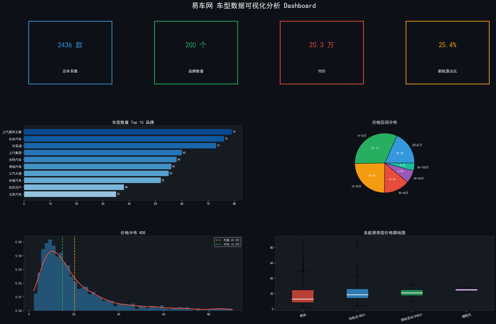
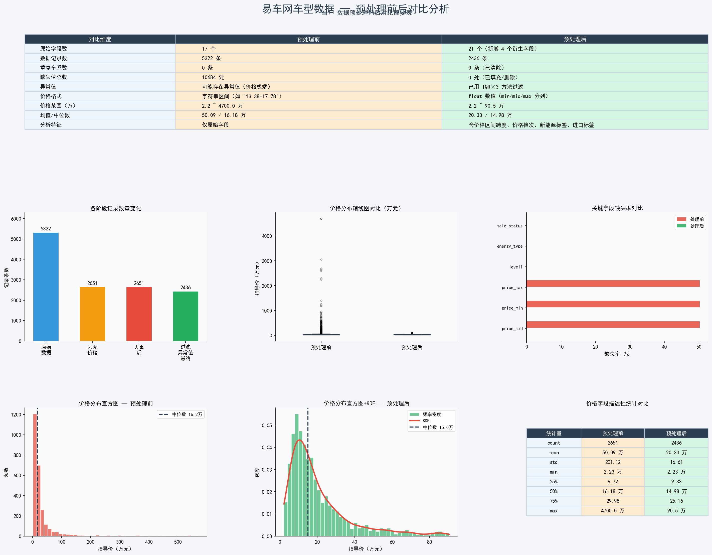
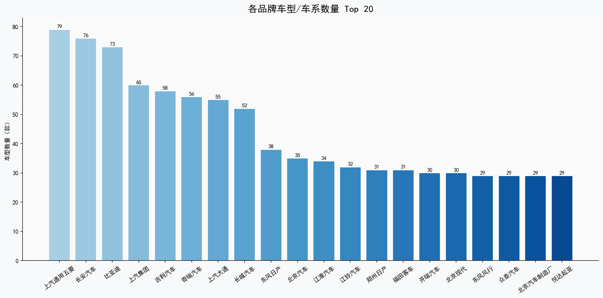
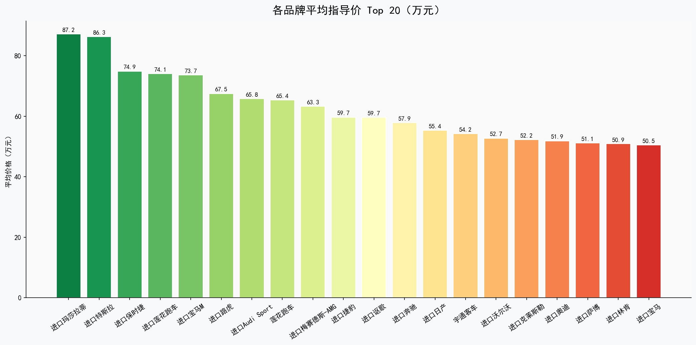
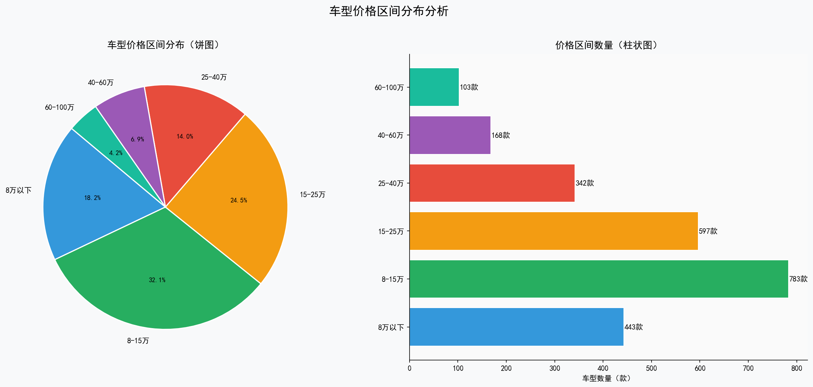
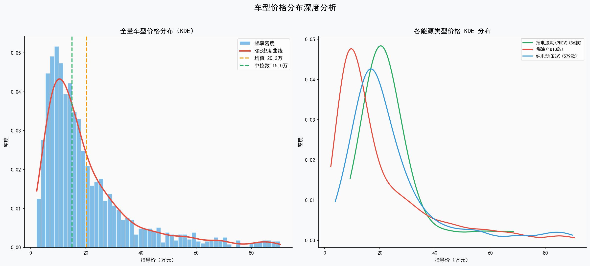
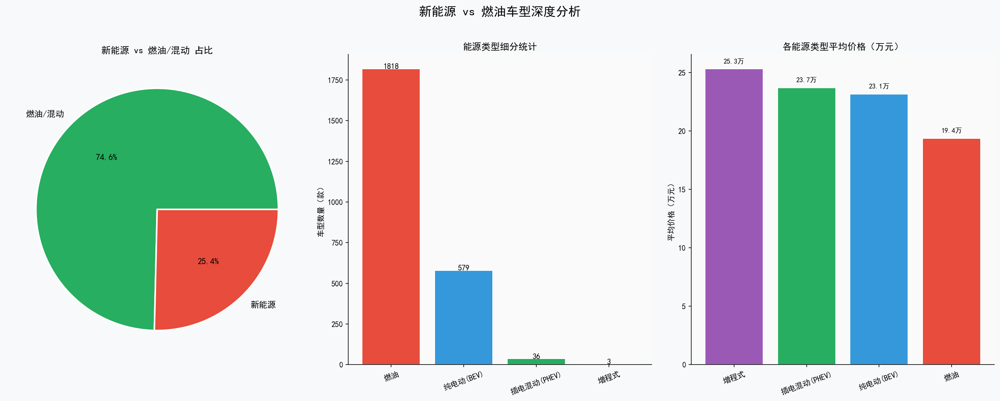
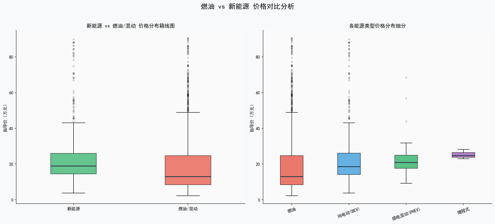

<div align="center">

# 📊 易车网车型数据爬取与可视化分析

**5322 条原始记录 → 2436 条清洁数据 → 10 张多维分析图**

[](#)
[](#)
[](#)
[](#)

### ▶ [**在线预览 https://shenyicong.github.io/yiche-car-analysis/**](https://shenyicong.github.io/yiche-car-analysis/)

</div>

<p align="center">
  
</p>

---

## 📌 项目概览

以易车网车型数据为对象，完整走通 **「接口爬取 → 数据清洗 → 多维可视化 → 结论输出」** 全流程。项目重点不在图表数量，而在**预处理环节的严谨性**：每一步都保留处理前后的数量变化，让数据缩水的原因可追溯、可复现。

| 指标 | 数值 |
|---|---|
| 采集原始记录 | **5322** 条 / 21 字段 |
| 清洗后有效记录 | **2436** 条（保留率 45.8%） |
| 覆盖品牌 | **200** 个 |
| 车系均价 | **20.3 万元** |
| 新能源占比 | **25.4%** |

---

## 🧹 数据预处理

清洗链路严格按「去无效 → 去重复 → 去异常」三步推进，每步输出数量变化：

| 步骤 | 方法 | 结果 |
|---|---|---|
| **① 缺失值处理** | 剔除 `price_mid` 为空或为 0 的记录（价格是核心分析维度，无价格则无分析价值） | 5322 → **2651** |
| **② 重复值处理** | 以 `serial_id` + `brand_name` 联合去重，`keep='first'` | 2651 → **2651**（无重复） |
| **③ 异常值处理** | **IQR × 3** 四分位距法，过滤 [0.5, 90.8] 万区间外的价格 | 2651 → **2436** |

### 为什么异常值系数取 3 而不是 1.5？

车价分布**强烈右偏**：绝大多数车型集中在 10–30 万，但超豪华品牌会拉到数百万元。

若用标准的 IQR × 1.5，上界约为 40 万，会把保时捷、奔驰 S 级等**真实的高价车**误判为异常值删除，反而破坏样本真实性。

因此放宽到 IQR × 3，上界提升至 90.8 万——只剪掉极端离群点，保留合理的高端车型。

<p align="center">
  
  <br>
  <sub>预处理前后分布对比：数据更紧凑，但右偏的长尾特征被完整保留</sub>
</p>

---

## 📈 可视化成果

### 品牌格局

<p align="center">
  
  
</p>

车型数量与均价呈现**明显的负相关**：上汽通用五菱、长安等品牌车系多但均价低；北京奔驰、一汽奥迪车系少但单价高——典型的大众市场与豪华市场分野。

### 价格结构

<p align="center">
  
  
</p>

价格分布呈显著右偏，核密度曲线峰值落在 15–20 万，与均值 20.3 万、中位数 15.0 万的差距相互印证。

### 能源类型

<p align="center">
  
  
</p>

新能源占比已达 25.4%，但箱线图显示其价格分布更集中、中位数略高于燃油车——说明当前新能源市场仍以中高端车型为主。

### 更多图表

| 图表 | 说明 |
|---|---|
| `05_level_price.png` | 车辆级别 × 价格区间对比 |
| `08_brand_bubble.png` | 品牌三维气泡图（数量 / 均价 / 新能源率） |
| `09_level2_heatmap.png` | 细分级别热力图 |
| `10_dashboard.png` | 综合看板（顶部四项核心指标） |

---

## 🚀 运行方式

### 环境准备

```bash
pip install -r requirements.txt
```

### 方式一：离线复现（推荐，无需凭证）

仓库已附带完整数据集，直接出图：

```bash
python yiche_car_analysis.py --offline
```

输出位于 `yiche_output/`，包含清洁数据 CSV 与全部 11 张图。

### 方式二：实时爬取

需要先在[易车开放平台](https://open.yiche.com/)申请接口凭证，再通过环境变量注入：

```powershell
# PowerShell
$env:YICHE_CID='你的CID'; $env:YICHE_SECRET='你的SECRET'
python yiche_car_analysis.py
```

```bash
# CMD / Bash
set YICHE_CID=你的CID && set YICHE_SECRET=你的SECRET
export YICHE_CID=你的CID YICHE_SECRET=你的SECRET
```

> ⚠️ **凭证未硬编码进源码**，统一从环境变量读取，避免密钥泄露。未配置时脚本会明确提示，不影响离线模式。

---

## 🗂️ 目录结构

```
yiche-car-analysis/
├─ yiche_car_analysis.py     主程序：爬取 / 清洗 / 绘图
├─ requirements.txt          依赖清单
├─ .env.example              凭证模板
├─ data/
│  ├─ yiche_raw.csv          原始数据（5322 条）
│  └─ yiche_clean.csv        清洁数据（2436 条）
└─ docs/
   ├─ 00_preprocess_comparison.png
   └─ charts/
      ├─ 01_brand_count.png
      ├─ 02_brand_avg_price.png
      ├─ 03_price_level_pie.png
      ├─ 04_energy_type.png
      ├─ 05_level_price.png
      ├─ 06_price_kde.png
      ├─ 07_energy_box.png
      ├─ 08_brand_bubble.png
      ├─ 09_level2_heatmap.png
      └─ 10_dashboard.png
```

---

## 🔍 实现要点

**接口签名**
易车接口要求 `X-Sign` 与 `X-Timestamp` 双头校验，签名规则为 `md5('cid=' + CID + '&param=' + json + SECRET + ts)`。`_sign()` 严格按此拼接，`json.dumps` 必须用 `separators=(',',':')` 压缩空白，否则签名对不上。

**全量抓取的翻页策略**
直接遍历 `KNOWN_MASTER_IDS` 品牌母类，再逐品牌拉取车系，避免依赖单一分页接口导致的漏采。

**中文字体**
matplotlib 默认不支持中文。`_setup_font()` 按 `simhei → 微软雅黑 → 宋体` 顺序探测系统字体并注册，同时关闭 `unicode_minus` 以正常显示负号。

**数据可复现**
每步清洗都打印数量变化（`5322 → 2651 → 2651 → 2436`），任何人重跑都能得到同一组数字。

---

## 📄 说明

课程设计作品，数据采集与分析代码为本人独立完成。数据仅用于教学分析，不涉及商业用途。
